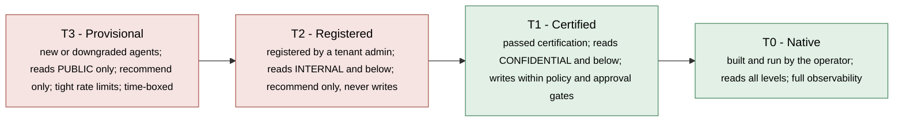
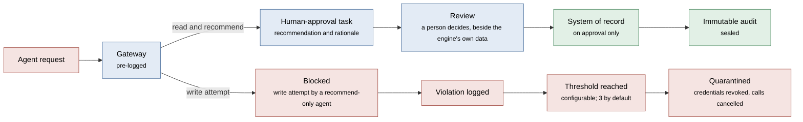
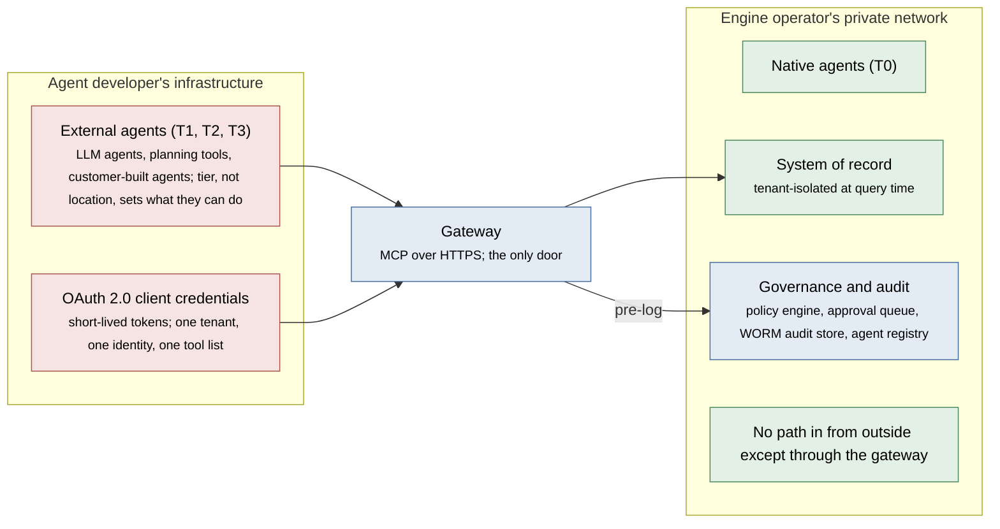

# Agentic Trust Architecture for FinOS

**A guide for engineers building FinOS engines and applications that connect to them**

## Contents

1. [In Plain Terms](#in-plain-terms)
2. [Trust Tiers](#trust-tiers)
3. [The Four Enforcement Layers](#the-four-enforcement-layers)
4. [What Happens to a Request](#what-happens-to-a-request)
5. [The Audit Trail](#the-audit-trail)
6. [Network, Identity and Isolation](#network-identity-and-isolation)
7. [For Engine Builders](#for-engine-builders)
8. [For Application Developers](#for-application-developers)
9. [Why This Design](#why-this-design)
10. [Design Principles](#design-principles)
11. [Glossary](#glossary)

## In Plain Terms

AI agents are starting to *act* inside finance and accounting systems, not just advise: posting journal entries, certifying balances, flagging exceptions, triggering workflows. An agent that can post to a ledger with no oversight and no audit trail is a control weakness, however accurate it usually is.

The FinOS trust architecture answers one question: **how can an engine let AI agents help with financial work while guaranteeing that nothing changes the books except through controls the customer defines?**

The short answer:

- Every agent is assigned a **trust tier**. The tier decides what the agent may read, whether it may act, and how closely it is watched.
- Every request passes **four independent enforcement layers**. Any one of them can stop a request on its own.
- Every request is **audited before it runs**, in storage that cannot be altered.
- Low-trust agents can **inform but not act**: they submit recommendations, and a person decides.

### Who This Is For

| You are… | Read this to learn… |
|---|---|
| **An engine builder** – implementing a FinOS-conformant engine from the specifications | What your engine must enforce, and where. See the checklist in *For Engine Builders*. |
| **An application developer** – building an agent or application that calls a FinOS engine | What your agent can and cannot do at each tier, and how to behave well. See *For Application Developers*. |

### Roles Used in This Guide

- **Engine operator** – the organization that runs a FinOS engine.
- **Tenant** – one customer organization served by the engine. Each tenant's data is isolated from every other tenant's.
- **Tenant admin** – the person at the customer who registers agents and sets their scopes.
- **Agent developer** – whoever builds an agent: the operator, a vendor, an integrator, or the customer.

In the checklists, **MUST**, **MUST NOT** and **SHOULD** carry their usual specification meanings (RFC 2119).

## Trust Tiers

Not all agents are equal, and the engine does not treat them as equal. There are four tiers, Tier 0 (T0) to Tier 3 (T3). The more trust a tier carries, the harder it is to earn and the more autonomy it allows.

*(Diagram 1: Trust Tiers)*

| Tier | Who it is for | How it runs | What it may do |
|---|---|---|---|
| **T3 – Provisional** | New registrations; agents downgraded after a lapse or a violation | Outside the engine's network | Read `PUBLIC` data only. Recommend only. Tighter rate limits and more detailed logging. Must advance within a fixed window or lose access. |
| **T2 – Registered** | External agents registered by a tenant admin, with scope approved by the operator: LLM-based agents, planning tools, customer-built agents | On the agent developer's own infrastructure, through the engine's gateway | Read `INTERNAL` data and below. Recommend only: it can never write, and every action needs human approval. |
| **T1 – Certified** | Agents from any developer that have passed the operator's certification process | Anywhere: the operator's infrastructure or the developer's own | Read `CONFIDENTIAL` data and below. May write and run workflows, but only within enforced policy, including any human-approval gates the tenant configures. |
| **T0 – Native** | Agents built and operated by the engine operator | Inside the engine's private network | Read all data, including `RESTRICTED`. May act autonomously within policy. Full observability of every reasoning step and tool call. |

**The key rule:** a T2 or T3 agent cannot post a journal entry, apply a payment, certify a balance, or execute a workflow step. This is not a policy setting that could be misconfigured. The write tools are absent from the agent's credentials and from the tools it can see.

### What Each Tier Can Do

| Tier | Read data | Submit recommendations | Write (journal entries, payments) | Execute workflows | Act without a human |
|---|---|---|---|---|---|
| T3 – Provisional | `PUBLIC` only | ✓ | ✗ | ✗ | ✗ |
| T2 – Registered | `INTERNAL` and below | ✓ | ✗ | ✗ | ✗ |
| T1 – Certified | `CONFIDENTIAL` and below | ✓ | Policy-gated | Policy-gated | ✓, within policy |
| T0 – Native | All levels | ✓ | ✓ | ✓ | ✓, within policy |

### Data Classification

Every record carries one of four classification levels. A tier sets the most sensitive level an agent may read, and each tier inherits access to every less sensitive level.

| Level | Typical finance data | Readable by |
|---|---|---|
| `PUBLIC` | Published financials, public filings, reference data | T0, T1, T2, T3 |
| `INTERNAL` | Management reports, operational dashboards | T0, T1, T2 |
| `CONFIDENTIAL` | Detailed general ledger, account balances, vendor records | T0, T1 |
| `RESTRICTED` | Personal data, bank details, pre-release earnings | T0 |

Reading is only half of the model. Writing to or acting on data carries separate human-approval requirements, which also scale with the tier.

### Moving Between Tiers

- **Start low.** Every new agent starts at T3. Completing registration and scope approval moves it to T2.
- **Earn certification.** Moving to T1 requires the operator's certification process – for example static code analysis, evaluation in a sandbox, and a security review – before activation.
- **Renew.** Certification expires on a fixed cycle (annually is typical). A lapse downgrades the agent automatically.
- **Time-box the provisional tier.** A T3 agent that does not advance within its window loses access.

## The Four Enforcement Layers

Good governance does not depend on one control. Every request from an external agent passes four layers, and each can stop the request on its own. A mistake in one layer is caught by the next.

```mermaid
flowchart LR
  ag["External agent<br/><small>any tier, any host</small>"]
  l1["1. Scoped credentials<br/><small>short-lived token; stops permissions it never held</small>"]
  l2["2. Gateway<br/><small>identity, PII scan, pre-log; stops any bypass</small>"]
  l3["3. Tool registry<br/><small>published tools only; stops high-impact tools</small>"]
  l4["4. Policy engine<br/><small>approval, compliance, risk, access, data rules; quarantine</small>"]
  gl["System of record<br/><small>general ledger</small>"]
  ag --> l1
  l1 --> l2
  l2 --> l3
  l3 --> l4
  l4 --> gl
  classDef blue fill:#E3EBF5,stroke:#4A6F9C,color:#000000
  class l1,l2,l3,l4 blue
  classDef green fill:#E2F0E6,stroke:#4D8A62,color:#000000
  class gl green
  classDef red fill:#F5E4E2,stroke:#A9574F,color:#000000
  class ag red
```

*(Diagram 2: The Four Enforcement Layers)*

1. **Scoped credentials.** A short-lived token encodes exactly what the agent may do: one tenant, one agent identity, a fixed list of tools. A write permission the token never contained cannot be used.
2. **Gateway.** The single, monitored entry point. It verifies identity, scans requests for personal data, and writes an audit record *before* the request reaches any backend system.
3. **Tool registry.** Only published tools exist for an agent. High-impact tools – posting journal entries, applying payments, executing workflows – are not available to recommend-only tiers at all. This is not configurable.
4. **Policy engine.** Real-time rules in five categories – approval, compliance, risk, access control, and data governance – covering period-close locks, personal-data safeguards, and human-approval thresholds. Repeated violations quarantine the agent automatically.

## What Happens to a Request

An external agent's request takes one of two paths.

*(Diagram 3: The Two Paths of an External Agent's Request)*

- **Read and recommend.** The agent reads data allowed by its tier and submits a recommendation, such as "certify account 1234". The recommendation becomes a human-approval task. A reviewer sees the agent's rationale next to the engine's own data, never the recommendation alone. Only an approved recommendation takes effect, and the outcome is sealed in the audit trail.
- **Attempt to write.** A recommend-only agent that tries to write is blocked. The attempt is logged as a violation. After a configurable number of violations (three by default), the agent is quarantined.

Large amounts can escalate: threshold-based approval policies can require a more senior reviewer above a configured value.

## The Audit Trail

Every AI-initiated action needs an audit trail that exists whether or not the action succeeded, whether or not the agent behaved correctly, and wherever the agent runs.

- **Pre-logged.** The audit record is written before the backend processes the request. If the network fails afterwards, the record still exists.
- **Immutable.** External agent activity is written to Write-Once-Read-Many (WORM) storage. Records cannot be changed or deleted.
- **Separated.** External and internal agent activity are stored as independent streams, so external activity can be reported on its own.
- **Retained.** Retention is set by the deployment. Seven years, with recent activity kept query-ready, is a common choice for Sarbanes-Oxley (SOX) obligations.
- **Point-in-time.** Each record captures the agent's tier *at the moment of the call*. A later downgrade or revocation never rewrites history.
- **Complete.** For human-approval tasks, the chain is preserved end to end: agent recommendation, reviewer identity, decision, timestamp, execution.

Each record contains:

| Field | Purpose |
|---|---|
| Agent identity, trust tier, tenant | Who acted, at what trust level, for whom |
| Source platform | Where the agent runs, so external activity can be filtered |
| Action requested | What the agent asked to do |
| Parameter hash | A tamper-evident fingerprint of the request |
| Outcome and policy result | What happened, and why |
| Personal-data flag | Whether the gateway detected personal data |
| Response time and timestamp | When, and how long |
| Model version (optional) | Reported voluntarily by external agents |

## Network, Identity and Isolation

External agents run on infrastructure the operator does not control. The architecture's job is to ensure they reach exactly what the tenant authorized, and that every access is logged.

*(Diagram 4: Network, Identity and Isolation)*

- **One door.** External agents of any tier can reach only the public gateway. Backend systems run on private networks with no path in from outside.
- **Standard protocols.** Agents connect with the Model Context Protocol (MCP) over HTTPS, which works through standard firewalls and proxies, and authenticate with OAuth 2.0 client credentials.
- **Short-lived, scoped tokens.** Each token is bound to one tenant, one agent identity and one tool list, and is refreshed before it expires.
- **Two-level tenant isolation.** The token is scoped to one tenant, and the data layer enforces tenant isolation again at query time. Even a valid token cannot return another tenant's data.
- **Point-in-time reads.** Read tools return certified, point-in-time snapshots, not live transactional state.
- **No self-elevation.** Scopes are set at registration by the tenant admin and approved by the operator. An agent cannot raise its own scope at runtime.
- **Revocation.** Revoking an agent invalidates its credentials: new token requests fail, and active tokens expire shortly after. The revocation itself is audited.
- **Quarantine.** Reaching the violation threshold revokes all of the agent's credentials immediately, cancels its pending calls, and raises an alert for human review. The damage a compromised agent can do is bounded by its token scope – for a T2 agent, read operations only.
- **Observability scales with trust.** T0 and T1 agents expose full reasoning traces and every action. External T2 and T3 agents are observed at the tool level, at the gateway.

## For Engine Builders

A FinOS-conformant engine implements the controls above. The checklist below groups them by layer.

**Trust and classification**

- The engine MUST assign every agent exactly one trust tier, and MUST map each tier to the highest data classification it may read, as in *Data Classification*.
- The engine MUST start every new agent at T3, and MUST downgrade an agent automatically when its certification lapses.
- The engine MUST expire T3 agents that do not advance within a configured window.

**Credentials and gateway**

- The engine MUST issue short-lived OAuth 2.0 tokens scoped to one tenant, one agent identity and one tool list.
- The engine MUST NOT include write tools in tokens issued to T2 or T3 agents.
- The engine MUST expose one gateway as the only network path for external agents, and MUST keep backend systems unreachable from outside.
- The gateway MUST verify identity and token scope on every call, and SHOULD scan request parameters for personal data.
- The gateway MUST write the audit record before forwarding the request to any backend.

**Tool registry and policy**

- The engine MUST expose to each agent only the published tools its token allows.
- The engine MUST make high-impact tools (journal entries, payments, workflow execution) unavailable to recommend-only tiers, with no configuration that can re-enable them.
- The engine MUST evaluate policy on every workflow step, for every tier including T0. Period-close locks MUST apply to all agents.
- The engine MUST convert recommendations from T2 and T3 agents into human-approval tasks, and MUST NOT execute them without an approval.
- The engine MUST count violations per agent and quarantine the agent at a configurable threshold (three by default).

**Audit**

- The engine MUST write external agent activity to WORM storage, separate from internal agent activity.
- Each audit record MUST capture the fields listed in *The Audit Trail*, including the agent's tier at the time of the call.
- For human-approval tasks, the engine MUST record the recommendation, the reviewer's identity, the decision and the timestamp.

**Isolation and lifecycle**

- The engine MUST enforce tenant isolation both in the token and in the data layer at query time.
- The engine MUST NOT allow an agent to raise its own scope at runtime.
- Revocation and quarantine MUST invalidate credentials, cancel pending calls, and be audited.

## For Application Developers

If you are building an agent or an application that calls a FinOS engine, this is what to expect and how to behave well.

1. **Register.** Your tenant admin registers your agent and sets its scope; the operator approves it. Your agent starts at T3 and moves to T2 when registration completes. To reach T1, go through the operator's certification process.
2. **Authenticate.** Use OAuth 2.0 client credentials. Tokens are short-lived: refresh before expiry, and expect a token to cover exactly one tenant.
3. **Connect.** Use MCP over HTTPS to the engine's gateway. It is the only endpoint you will reach.
4. **Discover, then call.** Call only the tools the gateway advertises for your token. At T2 or T3, never attempt a write tool: each attempt is a violation, and repeated violations quarantine your agent.
5. **Recommend with rationale.** At T2 and T3, actions are recommendations that become human-approval tasks. Include a clear rationale, because a reviewer will read it beside the engine's own data. Design for an asynchronous outcome: the decision may come much later, or never.
6. **Expect filtered data.** Data above your tier's classification is not returned. Reads are point-in-time snapshots, not live state.
7. **Keep personal data out of parameters.** The gateway scans request parameters; avoid sending personal data you do not need to send.
8. **Report your model version.** It is optional, but it makes your agent's audit records more useful.
9. **Handle revocation and quarantine.** If token requests start failing, your access has been revoked or your agent quarantined. Stop and alert your operator; do not retry in a loop.

### Example: A Quarter-End Accrual

A T1 (certified) agent supports the quarter-end accrual. General ledger detail is `CONFIDENTIAL`, so this work needs T1.

1. The agent reads the trial balance and open purchase orders, and finds $240,000 of received-but-unbilled costs that meet the accrual threshold. The reads are scope-checked and logged.
2. The agent proposes an accrual entry. The proposal is pre-logged before it reaches the ledger.
3. The tenant's policy requires approval above the threshold, so the proposal becomes a human-approval task.
4. The controller reviews the proposed entry beside the engine's certified numbers and approves it. The entry posts through the policy gate, and the audit record is sealed.

The same pattern – certified data, human approval, immutable audit – applies beyond the close:

- **Accruals analysis.** Find items that meet the accrual threshold and recommend entries with rationale.
- **Variance commentary.** Explain material period-over-period movements; accountants edit and approve.
- **AP and AR exception review.** Flag accounts that exceed thresholds or look anomalous, and recommend escalation, write-off or follow-up.
- **Budget versus actual narrative.** Draft management commentary for material deviations; the planning team approves.

### Why Route Agents Through a FinOS Engine

| An agent calling the ERP directly | An agent going through a FinOS engine |
|---|---|
| Data access is not recorded | Every access is pre-logged |
| Permissions depend on raw ERP API keys | Token scope is enforced at every call |
| Data is not certified or reconciled | Analysis uses certified, reconciled data |
| Approval is informal | Every recommendation enters a structured approval queue |
| No unified view of agent activity | All agents are visible in one governance view |

## Why This Design

Other approaches exist. Each has trade-offs that matter when the data is a general ledger.

| | No governance ("just give agents API keys") | Policy only (rules, no enforcement layers) | Walled garden (block all external agents) | Tiered trust architecture |
|---|---|---|---|---|
| External agents can read financial data | Unrestricted | If policy allows | Blocked | Scoped, logged, tenant-isolated |
| External agents can post journal entries | No barrier | Depends on configuration | Blocked | Impossible for T2 and T3 by construction |
| Audit trail for every action | Usually none | Varies, often after the fact | Not applicable | Pre-logged and immutable |
| Human approval for writes | Not enforced | Can be bypassed | Not applicable | Structural for T2 and T3; policy-enforced for T1 |
| Third-party agents can contribute | Yes, with full risk | Yes, with limited controls | No | Yes: read and recommend, human-approved |
| Response to a misbehaving agent | None | Alert only | Not applicable | Automatic quarantine |
| Cross-tenant isolation | Depends on implementation | Policy-dependent | Not applicable | Token scope and data-layer isolation |

Blocking all external agents is the wrong answer: finance work runs across planning tools, consolidation systems and integrator-built automation. The tiered design is a third path – open enough for that ecosystem, strict enough for auditors.

## Design Principles

1. **Trust is earned, not assumed.** Every agent starts at the lowest tier. Advancing requires certification, ongoing compliance and periodic review; a lapse downgrades automatically.
2. **Enforcement is structural, not advisory.** Write exclusions, tenant isolation and token scoping are enforced in credentials and protocol, not in rules that can be misconfigured. Approval gates for write-capable agents are enforced separately, by policy.
3. **The audit trail is pre-logged.** Evidence never depends on a successful response.
4. **Human judgment gates consequential actions.** For external agents the approval gate cannot be configured away.
5. **Observability scales with trust.** More trust brings more capability and more visibility.
6. **History is point-in-time.** Records show the tier an agent held when it acted, not the tier it holds today.

## Glossary

| Term | Meaning |
|---|---|
| Agent | An AI program that can take actions, not only answer questions. |
| LLM | Large language model: the kind of AI that reads and reasons over text. |
| Trust tier (T0–T3) | From most to least trusted: Native (T0), Certified (T1), Registered (T2), Provisional (T3). |
| Human approval (HITL) | Human in the loop: a person must review and approve before an action takes effect. |
| Token, scope | A short-lived credential, and the exact list of things it allows. |
| Tenant | One customer's isolated space; data never crosses between tenants. |
| Gateway | The single, monitored entry point every external agent must pass through. |
| MCP | Model Context Protocol: a standard way for an AI agent to call tools over HTTPS. |
| OAuth 2.0 | An industry-standard way for software to authenticate without sharing passwords. |
| WORM | Write-Once-Read-Many: storage where records cannot be changed or deleted. |
| PII | Personally identifiable information. |
| SOX | Sarbanes-Oxley: the U.S. law setting financial-reporting controls for public companies. |
